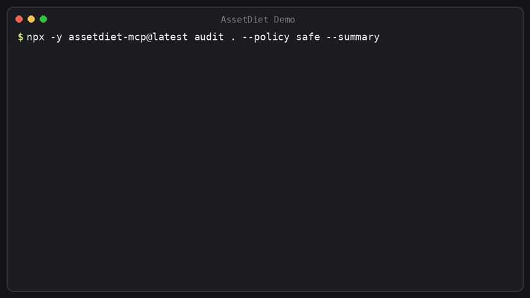

<div align="center">

<picture>
  <source media="(prefers-color-scheme: dark)" srcset="docs/assets/assetdiet-hero.svg" />
  <source media="(prefers-color-scheme: light)" srcset="docs/assets/assetdiet-hero.svg" />
  
</picture>

<br /><br />

# AssetDiet

**Asset intelligence for AI coding agents — audit, optimize, and roll back media safely.**

[](https://www.npmjs.com/package/assetdiet-mcp)
[](https://github.com/092Abdullah/AssetDiet/actions/workflows/ci.yml)
[](LICENSE)
[](package.json)
[](docs/mcp-tools.md)
[](docs/security.md)

[One-Command Setup](#-one-command-setup) · [Try With Your Agent](#-try-this-with-your-agent) · [Code Migration](#-beyond-files-codebase-reference-migration) · [Supported Formats](#-supported-asset-formats) · [Safety & Rollback](#-safety--atomic-rollback) · [Docs](#-documentation)

<br />

<a href="#-one-command-setup">
  
</a>

</div>

---

AI coding agents build frontend UIs in seconds, but treat media as opaque blobs — committing 4 MB raw camera photos, uncompressed SVGs, and duplicate icons straight into git. **AssetDiet gives your agent eyes on media**: auditing repos in milliseconds, executing lossless native optimizations, updating source code references, and keeping every byte reversible.

---

## ⚡ One-Command Setup

Connect AssetDiet to your AI coding assistant with zero manual configuration:

```bash
npx -y assetdiet-mcp@latest setup --yes
```

> Automatically detects and registers AssetDiet with **Cursor**, **Claude Desktop**, **Claude Code**, **Windsurf**, and **Codex** with timestamped `.bak` configuration backups.

### Real-World Results

```
public/hero.png          1.8 MB  →   42 KB   (−97.7%)
public/icons/logo.svg     18 KB  →  3.1 KB   (−83.0%)
models/character.glb     4.2 MB  →  1.1 MB   (−74.0%)
```

---

## 🤖 Try This With Your Agent

Once configured, copy and paste this prompt into your AI coding assistant (Cursor Composer, Claude Code, Windsurf, or Claude Desktop):

```markdown
Run an AssetDiet audit on this repo under the safe policy. Show me the top assets by potential savings, any exact duplicates, and a short optimization plan. Don't change any files yet.
```

Your agent will call `assetdiet_audit`, index SHA-256 hashes, surface duplicate groups, and outline a risk-free proposal before asking for your go-ahead.

---

## 💻 Or Run from Your Terminal

```bash
# 1. Read-only audit with instant savings & duplicate discovery
npx -y assetdiet-mcp@latest audit . --policy safe

# 2. Or get a concise 3-line scorecard summary
npx -y assetdiet-mcp@latest audit . --policy safe --summary

# 3. Apply lossless optimizations with atomic journal safety
npx -y assetdiet-mcp@latest optimize . --policy safe
```

<details>
<summary>🛠️ <b>Contributing / Building from Source</b></summary>

```bash
git clone https://github.com/092Abdullah/AssetDiet.git
cd AssetDiet
pnpm install
pnpm build
pnpm test
```

</details>

---

## 🔗 Beyond Files: Codebase Reference Migration

Most optimizers only touch files on disk. **AssetDiet can also update your code when formats change.**

When converting heavy legacy formats (like `.png` to modern `.webp` or `.avif`), your agent uses AssetDiet's AST and regex reference engine:

- **`assetdiet_find_references`**: Traces every code, JSX, TS, CSS, and HTML reference to an asset across the repository.
- **`assetdiet_migrate_references`**: Atomically updates import statements and asset paths in your source files to match the new optimized filenames.

```tsx
// Before
import hero from "./hero.png";
;

// After assetdiet_migrate_references
import hero from "./hero.webp";
;
```

---

## 📦 Supported Asset Formats

AssetDiet uses battle-tested native engines and WebAssembly parsers. Zero cloud roundtrips.

| Format                                            | Category      | Engine               | Capabilities                                                                                 |
| :------------------------------------------------ | :------------ | :------------------- | :------------------------------------------------------------------------------------------- |
| `.png`, `.jpg`, `.jpeg`, `.webp`, `.avif`, `.gif` | **Raster**    | **Sharp (libvips)**  | Lossless compression, metadata stripping, palette quantization, alpha preservation           |
| `.svg`                                            | **Vector**    | **SVGO**             | XML comment stripping, unused group cleanup, path precision rounding, `viewBox` preservation |
| `.glb`, `.gltf`                                   | **3D Models** | **glTF-Transform**   | Coincident vertex welding, mesh deduplication, unused material/sampler pruning               |
| `.mp4`, `.webm`                                   | **Video**     | **FFmpeg / FFprobe** | H.264/VP9 transcoding, atomic temporary swaps (auto-detected on host system)                 |
| `.woff2`, `.woff`, `.ttf`, `.otf`                 | **Fonts**     | **Font Engine**      | Metadata extraction, glyph table analysis, family duplicate detection                        |

---

## 🔄 How AssetDiet Works

<div align="center">
  
</div>

1. **Scan & Graph**: Traverses repository files (respecting `.gitignore`, `.assetdietignore`, and standard build excludes), hashes content with SHA-256, and links code references.
2. **Policy & Plan**: Evaluates opportunities against your chosen policy (`safe`, `balanced`, or `aggressive`) and creates an in-memory execution plan.
3. **Engine Optimization**: Dispatches each asset to its native engine, writing to isolated temporary swap files (`.tmp.<random>`).
4. **Verification & Commit**: Deep-validates decodability and dimensions. On success, atomically swaps the file. On failure, discards the temporary file leaving your original intact.

---

## 🛡️ Safety & Atomic Rollback

Every file operation is 100% reversible:

1. **Pre-Optimization Backups**: Exact byte-for-byte originals are saved to `.assetdiet/backups/<runId>/` before modification.
2. **Write-Ahead Journal**: State transitions are logged in `.assetdiet/runs/<runId>.json`.
3. **Atomic Replacements**: Uses OS-level atomic renames (`fs.rename`). Files are never partially overwritten.
4. **Instant Restore**:
   ```bash
   npx -y assetdiet-mcp@latest restore --run <runId>
   ```

### 🎯 Optimization Policy Matrix

| Policy | Format Conversion | Quality Target | Max Dimensions | Code Ref Migration | Visual Fidelity (SSIM) | Typical Savings |
| :--- | :--- | :--- | :--- | :--- | :--- | :--- |
| **`safe`** *(default)* | ❌ Same extension only | Lossless / 85 | Original (no resize) | ❌ Untouched | 100% Identical (SSIM ≥ 0.98) | **15–35%** |
| **`balanced`** | ✅ PNG/JPEG → WebP | High Quality (~85) | Original (no resize) | ✅ Atomic code updates | Near-imperceptible (SSIM ≥ 0.95) | **40–70%** |
| **`aggressive`** | ✅ WebP/AVIF + Quantize | Compact (~75) | Capped at 2560px | ✅ Atomic code updates | Perceptual (SSIM ≥ 0.88) | **60–85%** |
| **`audit`** | ❌ None (read-only) | N/A | Original | ❌ None | 100% Unchanged | Simulation only |

---

## 📊 Real-World Results

AssetDiet benchmarked on typical web and game repository assets:

| Asset Type | Original File | Policy | Optimized Result | Savings | SSIM Score | Code References Migrated |
| :--- | :--- | :--- | :--- | :--- | :--- | :--- |
| **Landing Hero** | `hero.png` (4.8 MB) | `balanced` | `hero.webp` (642 KB) | **-86.6%** | `0.987` | 3 files (`index.tsx`, `Hero.jsx`) |
| **Product Photo** | `product.jpg` (2.1 MB) | `balanced` | `product.webp` (310 KB) | **-85.2%** | `0.979` | 2 files (`store.ts`, `Card.tsx`) |
| **App Icon** | `icon.png` (320 KB) | `safe` | `icon.png` (214 KB) | **-33.1%** | `1.000` | In-place (same extension) |
| **UI Vector** | `illustrations.svg` (184 KB) | `safe` | `illustrations.svg` (42 KB) | **-77.2%** | Vector Clean | In-place (`viewBox` preserved) |
| **Demo Clip** | `demo.mp4` (14.2 MB) | `balanced` | `demo.mp4` (4.1 MB) | **-71.1%** | Stream Parity | In-place (H.264 CRF 23) |
| **3D Asset** | `character.glb` (8.6 MB) | `balanced` | `character.glb` (3.2 MB) | **-62.8%** | Mesh Welded | In-place (glTF-Transform) |

---

## 🔒 100% Local & Private

- **Zero Telemetry**: No analytics, tracking beacons, or phone-home pings.
- **100% Local Execution**: All processing happens on your CPU using embedded native engines. Media never leaves your machine.
- **Safe Agent Integration**: Only concise text metadata is passed over local stdio to your assistant.

---

## 📚 Documentation

- [CLI Reference](docs/cli.md) — Commands for `setup`, `doctor`, `audit`, `optimize`, `restore`, and `mcp`.
- [MCP Tools Reference](docs/mcp-tools.md) — Complete specifications for all 16 Model Context Protocol tools.
- [Configuration & Ignore Rules](docs/configuration.md) — Customizing `.assetdietignore`, policies, and `assetdiet.config.json`.
- [Installation Guide](docs/installation.md) — Global installation, manual configuration, and platform guides.
- [Architecture](docs/architecture.md) — Monorepo design, self-contained distribution, and stdio isolation.
- [Security Policy](SECURITY.md) — Security practices and reporting.
- [Changelog](CHANGELOG.md) — Release history.

---

## 📄 License

[MIT](LICENSE) © 2026 [AssetDiet Contributors](https://github.com/092Abdullah/AssetDiet)
