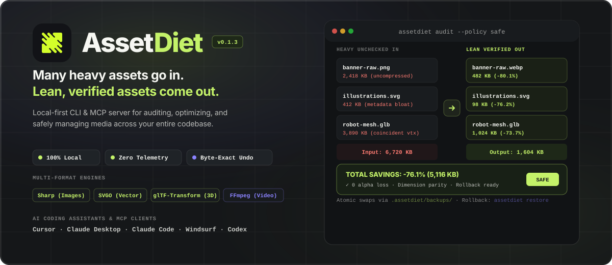
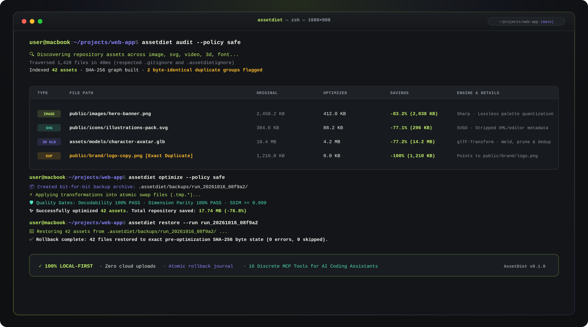
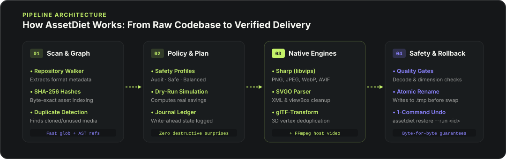
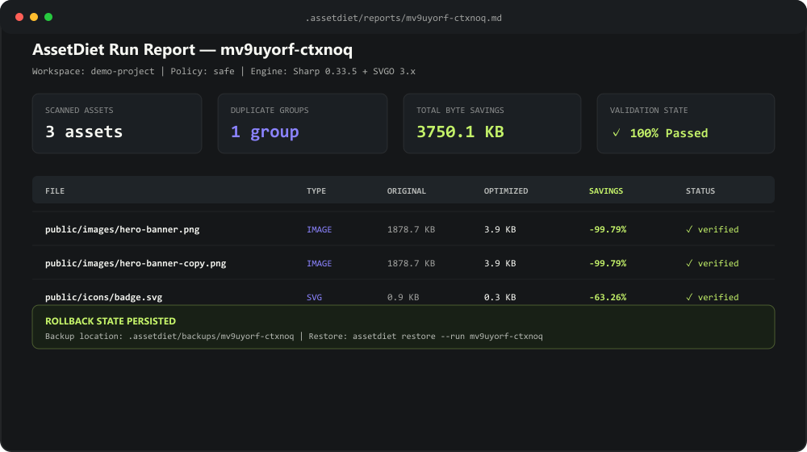

<div align="center">

<picture>
  <source media="(prefers-color-scheme: dark)" srcset="docs/assets/assetdiet-hero.svg" />
  <source media="(prefers-color-scheme: light)" srcset="docs/assets/assetdiet-hero.svg" />
  
</picture>

<br /><br />

# AssetDiet

**Local-first CLI and MCP server for auditing, optimizing and safely managing images, SVGs, videos and 3D assets in codebases.**

[](https://github.com/092Abdullah/AssetDiet/actions/workflows/ci.yml)
[](LICENSE)
[](package.json)
[](docs/mcp-tools.md)
[](docs/security.md)

[Quick Start](#-quick-start-verified-source-install) · [Demo](#-terminal-demo) · [AI Prompt](#-using-with-ai-coding-assistants) · [Supported Formats](#-supported-asset-formats--engines) · [Workflow](#-how-assetdiet-works) · [Policies & Safety](#-policies-safety--rollback-engine) · [Documentation](#-documentation)

<br />

<a href="#-terminal-demo">
  
</a>

</div>

---

## 💡 The Problem AssetDiet Solves

Modern web and mobile repositories routinely accumulate bloated assets: uncompressed raster images, SVG icons cluttered with vector-editor metadata, duplicate branding files, and heavy 3D models. AI coding assistants generate frontend features and UI components quickly, but treat repository media as opaque blobs. Assistants cannot natively inspect asset dimensions, run lossless compression, verify decodability, or safely restore modified files if an optimization fails.

**AssetDiet** bridges this gap. It provides a local-first CLI and a Model Context Protocol (MCP) server that empowers AI assistants (Cursor, Claude Desktop, Claude Code, Windsurf, Codex) and developers to inventory media, find high-value compression opportunities, optimize files atomically, and reverse any operation byte-for-byte.

> _“Many heavy assets go in. Lean, verified assets come out.”_

---

## ⚡ Quick Start: Verified Source Install

> [!NOTE]
> Until `assetdiet-mcp` is published to the public npm registry, source installation is the tested, verified method to use AssetDiet. (Instructions for post-publication `npx` commands are documented in the [Installation Guide](docs/installation.md)).

### 1. Clone and Build

```bash
git clone https://github.com/092Abdullah/AssetDiet.git
cd AssetDiet
pnpm install
pnpm build
pnpm test
```

### 2. Verify Your System Environment

Run the built diagnostic doctor to inspect engine readiness and installed assistants:

```bash
node packages/assetdiet-mcp/dist/cli.js doctor
```

### 3. Run a Read-Only Codebase Audit

Simulate potential byte savings across your project without modifying any files:

```bash
node packages/assetdiet-mcp/dist/cli.js audit /path/to/your/project --policy safe
```

### 4. Configure Your AI Coding Assistant

Automatically detect and register AssetDiet with **Cursor**, **Claude Desktop**, **Claude Code**, **Windsurf**, or **Codex**:

```bash
# Preview proposed changes (dry-run)
node packages/assetdiet-mcp/dist/cli.js setup --dry-run

# Apply configuration with automated backup (.bak) creation
node packages/assetdiet-mcp/dist/cli.js setup --yes
```

---

## 🤖 Using with AI Coding Assistants

Once registered, your AI coding assistant has direct access to AssetDiet's 16 discrete MCP tools.

### Realistic Assistant Prompt

> _"Run an asset audit across this repository under the safe policy. Tell me which images, SVGs, or 3D models have high potential savings, flag any duplicate files, and prepare an optimization plan before applying changes."_

### What the Assistant Does

1. **Discovery & Estimation**: The assistant calls `assetdiet_audit` in read-only mode to scan the workspace, compute SHA-256 hashes, group byte-identical duplicates, and calculate savings.
2. **Review & Approval**: The assistant presents a concise proposal:
   ```
   AssetDiet Audit Proposal:
   • public/images/hero-banner.png (1.8 MB) -> 3.9 KB (-99.8%) [Exact duplicate of public/images/hero-banner-copy.png]
   • public/icons/badge.svg (0.9 KB) -> 0.3 KB (-63.3%) [Editor metadata stripped]
   Total estimated savings: 3,750.1 KB across 3 assets.
   ```
3. **Atomic Modification**: Upon your approval, the assistant calls `assetdiet_optimize`, which creates an archive in `.assetdiet/backups/<runId>/`, applies transformations into temporary files, verifies output integrity, and atomically swaps them.
4. **Instant Rollback**: If you ever want to revert, prompt your assistant: _"Undo the last asset optimization pass,"_ and it calls `assetdiet_restore` to restore the exact original byte state.

---

## 📦 Supported Asset Formats & Engines

AssetDiet delegates optimization to industry-standard, battle-tested native engines and WebAssembly parsers:

| Media Category      | Supported Formats                                          | Primary Engine       | Execution Mode            | Capabilities                                                                                                         |
| ------------------- | ---------------------------------------------------------- | -------------------- | ------------------------- | -------------------------------------------------------------------------------------------------------------------- |
| **Raster Images**   | `.png`, `.jpg`, `.jpeg`, `.webp`, `.avif`, `.tiff`, `.gif` | **Sharp (libvips)**  | Embedded Native           | Metadata stripping, lossless compression, palette quantization, alpha channel preservation.                          |
| **Vector Graphics** | `.svg`                                                     | **SVGO**             | Embedded Library          | XML/comment stripping, unused group cleanup, path precision rounding, `viewBox` preservation.                        |
| **3D Models**       | `.glb`, `.gltf`                                            | **glTF-Transform**   | Embedded Library          | Coincident vertex welding, mesh deduplication, unused material/sampler pruning.                                      |
| **Video**           | `.mp4`, `.webm`                                            | **FFmpeg / FFprobe** | Optional Host Engine      | Direct subprocess execution, H.264/VP9 transcoding, atomic temporary swaps. Safely skipped if not in `PATH`.         |
| **Fonts**           | `.woff2`, `.woff`, `.ttf`, `.otf`                          | **Font Scanner**     | Production / Experimental | Metadata extraction and duplicate family detection are production-ready. Character-level subsetting is experimental. |

---

## 🔄 How AssetDiet Works

The optimization pipeline moves through four disciplined stages:

<div align="center">
  
</div>

1. **Scan & Graph**: Traverses the directory tree, computes SHA-256 content hashes, indexes metadata, and identifies duplicate groups.
2. **Policy & Plan**: Evaluates assets against your selected policy (`safe`, `balanced`, or `aggressive`), runs dry-run simulations, and writes an atomic journal entry.
3. **Engine Optimization**: Dispatches each file to its specialized engine. Work is written to temporary swap files (`.tmp.<random>`) rather than in-place.
4. **Verification & Commit**: Validates decodability and dimensional parity. On pass, the temporary file is atomically renamed (`fs.rename`). On failure, the temporary file is discarded, leaving the original untouched.

---

## 📊 Optimization & Validation Report Preview

Every run produces an audit and validation report with byte-level precision:

<div align="center">
  
</div>

---

## 🛡️ Policies, Safety & Rollback Engine

### Optimization Policies

- **`audit`**: Strictly read-only mode. Computes realistic savings by analyzing file structures and running in-memory simulations without touching files on disk.
- **`safe`** _(Default)_: Strictly lossless or visually indistinguishable optimizations. Preserves exact file formats, dimensions, transparency, and audio streams. Ideal for automated CI pipelines and production codebases.
- **`balanced`**: Perceptually lossless transformations with modern format opportunities (WebP/AVIF quality 85, video CRF 23). Best for web applications where transfer size directly impacts user experience.
- **`aggressive`**: Maximum byte reduction for mobile bundles or bandwidth-constrained deployments (quality 75, video CRF 28, geometry reduction).

### Rollback Engine

Every file modification in AssetDiet is backed by multi-layered recovery guarantees:

1. **Pre-Optimization Backups**: Before any asset is touched, a byte-for-byte copy is stored in `.assetdiet/backups/<runId>/`.
2. **Write-Ahead Journal**: State transitions are journaled in `.assetdiet/runs/<runId>.json`. If a run is interrupted by power loss or user cancellation, state is preserved.
3. **Atomic Replacements**: Temporary files are validated before the atomic filesystem swap. Files are never overwritten partially.
4. **One-Command Restore**:
   ```bash
   node packages/assetdiet-mcp/dist/cli.js restore --run <runId>
   ```

---

## 🔒 Security, Privacy & Local Execution

- **100% Local Execution**: All asset analysis and compression runs locally on your machine using embedded native libraries and WebAssembly. AssetDiet never transmits your media files to any remote server, cloud bucket, or external API.
- **Zero Telemetry**: Contains no analytics tracking, phone-home beacons, or usage telemetry.
- **Safe Assistant Integration**: Only text metadata (file paths, dimensions, byte sizes, savings) is shared over local stdio with your AI assistant. Assistant configuration files are backed up to `.bak` files prior to modification.

---

## 📚 Documentation

Detailed guides and references:

- [Installation Guide](docs/installation.md) — Source installation, global install, manual MCP configuration, and platform guides.
- [CLI Reference](docs/cli.md) — Comprehensive command reference for `setup`, `doctor`, `uninstall`, `scan`, `audit`, `optimize`, `restore`, and `mcp`.
- [MCP Tools Reference](docs/mcp-tools.md) — Input schemas and specifications for all 16 Model Context Protocol tools.
- [Configuration & Policies](docs/configuration.md) — Detailed guide to `safe`, `balanced`, and `aggressive` profiles, ignore rules, and `assetdiet.config.json`.
- [Architecture](docs/architecture.md) — Monorepo design, self-contained distribution package, and stdio isolation model.
- [Troubleshooting & FAQ](docs/troubleshooting.md) — Common diagnostic procedures and solutions.
- [Contributing Guide](CONTRIBUTING.md) — How to contribute, run tests, and submit pull requests.
- [Security Policy](SECURITY.md) — Vulnerability disclosure policy and reporting process.
- [Changelog](CHANGELOG.md) — Release history and version updates.

---

## 📄 License

[MIT](LICENSE) © 2026 [AssetDiet Contributors](https://github.com/092Abdullah/AssetDiet)
